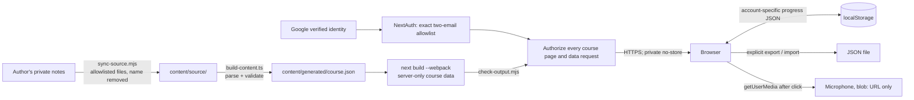

# Threat model

Covers authenticated server-rendered access, the content pipeline and local progress.
Method is STRIDE over the data flow below.

## Data flow

Trust boundaries: private notes to repository (personal data), build machine to host
(published artefacts), host to browser (executed as script), file import to app
(untrusted JSON), Google identity to server session, and account changes within
one browser profile. Listening remains coming soon, not scored.

## Spoofing

The Google provider validates the OpenID response, PKCE, state and nonce. A verified
email must exactly match one of two configured addresses. Domain matches and plus
aliases do not grant access. Missing or malformed configuration denies access.
Every course page and Next data request uses a shared server guard and rechecks the
current allowlist. Sessions use encrypted HTTP-only cookies and an absolute eight-hour
maximum. Synthetic tests cover both approved identities, invalid sessions, third-party
and alias emails, unverified identities, expiry, future timestamps and data URLs.
They do not prove that the configured Google client or real consent flow works.
The site cannot be framed (`frame-ancestors 'none'`, `X-Frame-Options: DENY`), which
prevents a look-alike page from overlaying it.

## Tampering

Course content is versioned in the repository; changes are reviewable diffs.
`build-content.ts` fails the build on any structural mismatch between exercises and
answer keys, so a broken or partial edit cannot ship silently.

Content and learner input are rendered as React text nodes. There is no
`dangerouslySetInnerHTML`, `innerHTML`, `eval` or `Function()`; lint rules and
`npm run verify` both enforce this. Links in content are allowlisted: `https:` without
credentials, or a fixed set of internal routes.

Imported progress files are untrusted. `parseImport` caps the size at 1 MB, checks the
schema version, validates every field type and range, and restricts object keys to
`[a-z0-9-]`, which blocks `__proto__` keys. Validated records are reconstructed rather
than recursively merged into application objects.

## Repudiation

Authentication failures record categorical errors without identities, tokens or
callback payloads. Build provenance comes from git history and CI logs. There is
no learner activity audit database.

## Information disclosure

The learner profile, start note and personal logs are never copied into the
repository (`sync-source.mjs` uses an allowlist) and the learner's name is replaced.
`verify` and `check-output.mjs` fail if the name appears in source or build output.

Progress stays in account-specific `localStorage` keys. Anonymous data is assigned
only after confirmation and the original is retained if saving fails. Recordings
stay in memory and are discarded when the
tab closes. `Referrer-Policy: no-referrer` and `rel="noopener noreferrer"` prevent
leaking page URLs to external resources.

Course HTML and JSON use private no-store caching. Build checks reject prerendered
course routes and vocabulary examples in public bundles; navigation comes from the
authorized server. Generated content has no download API. Provider access tokens and
secrets are not sent in browser session responses. Configuration is server-only.
Login cannot retract content from the public Git repository, earlier deployments or
copies already retrieved. Separate browser profiles are needed to prevent another
person with browser-profile access from inspecting local progress.

## Denial of service

Server rendering and Google identity are availability dependencies. Infrastructure
rate limiting and denial-of-service mitigation remain hosting responsibilities;
no claim is made that this app supplies them. Import size is capped. Stored lists (mistakes, study
days) are bounded so `localStorage` cannot grow without limit; a failing write shows a
warning instead of crashing.

## Elevation of privilege

CSP is `default-src 'none'` with `script-src 'self'`, `style-src 'self'`,
`object-src 'none'`, `base-uri 'none'` and `form-action 'none'`, without
`unsafe-inline` or `unsafe-eval`. Next.js 16's default Turbopack build injects an inline
bootstrap script, so the project builds with `--webpack`, whose Pages Router output
contains only external scripts and a non-executable `application/json` data block.
`check-output.mjs` fails the build if an inline executable script, inline style, event
handler or `javascript:` URL ever appears.

`Permissions-Policy` blocks camera, geolocation, payment and USB, and allows the
microphone for the site's own origin only.

CI actions are pinned by commit SHA, the workflow token is read-only by default,
checkout does not persist credentials, and downloaded tools are checksum-verified.
`check-codeql.mjs` rejects SARIF findings with security severity 7 or greater,
so a successful analysis upload alone cannot make the security gate green.

The historical static preview builds its route map from the output directory at startup.
Requests only look up entries in that map; no request-derived path is passed to the
filesystem. Traversal and malformed-URL regression tests enforce this boundary.
It must not be used to deploy the authenticated application; use the Next server.

## Residual risks

- Turbopack inline scripts: if a future Next.js release removes webpack support or adds
  inline scripts to webpack output, the build fails closed. The fix would be a
  hash-based CSP, not `unsafe-inline`.
- Real Google login requires an environment-specific smoke test by the users.
- Existing public repository history and old deployments remain publicly readable.
- Revocation without an allowlist/secret change is bounded by the eight-hour lifetime;
  sessions are not backed by a revocation database.
- Shared devices: anyone using the same browser profile can read the progress. Accepted;
  the learner can delete it under "Progress".
- Answer matching can reject a valid alternative phrasing. Accepted; the learner can
  mark "My answer was also correct", which is recorded honestly as a self-check.

## Enforcement

| Check | Defends against |
| --- | --- |
| CSP present and strict, no `unsafe-*` or remote origins | Script injection, config drift |
| Required security headers present | Clickjacking, sniffing, feature abuse |
| Built HTML has no inline script, style or handler | CSP regression by framework change |
| No HTML injection, `eval` or inline styles in source | XSS, CSP bypass |
| Links allowlisted to `https:` or internal routes | Script-scheme injection |
| No learner name or personal files in content or output | Personal data disclosure |
| Exact dependency pins, four runtime packages, lockfile | Supply chain drift |
| Request-time guards, no static course data, private caching | Unauthorized course access |
| Account storage namespaces and confirmed migration | Accidental progress mixing |
| Actions pinned to SHAs, read-only token | CI compromise |
| CodeQL High/Critical SARIF gate | Security findings hidden by a successful upload |
| Preview route allowlist and traversal tests | Request-derived filesystem access |
| No secret-shaped strings, gitleaks on full history | Credential leakage |
| Import schema validation (unit tests with hostile input) | Malicious progress files |

`scripts/verify-negative.mjs` mutates a temporary copy of the repository to confirm
each static check actually fails, so the suite cannot silently become a no-op.

Relevant controls: OWASP Top 10 A01, A02, A03, A05, A06, A08.

Revisit when changing identity providers, introducing cloud progress, AI feedback,
speech recognition, or another runtime dependency. No SQL or cloud-provisioning
boundary is introduced by this change.
