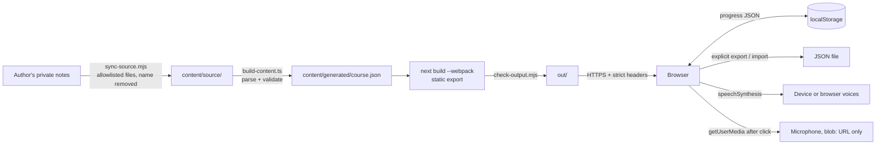

# Threat model

Covers the static site, the content pipeline and learner data in the browser.
Method is STRIDE over the data flow below.

## Data flow

Trust boundaries: private notes to repository (personal data), build machine to host
(published artefacts), host to browser (executed as script), file import to app
(untrusted JSON), browser to speech service (course text only).

## Spoofing

No authentication exists because there is nothing user-specific on a server. The
site cannot be framed (`frame-ancestors 'none'`, `X-Frame-Options: DENY`), which
prevents a look-alike page from overlaying it.

## Tampering

Course content is versioned in the repository; changes are reviewable diffs.
`build-content.ts` fails the build on any structural mismatch between exercises and
answer keys, so a broken or partial edit cannot ship silently.

Content and learner input are rendered as React text nodes. There is no
`dangerouslySetInnerHTML`, `innerHTML`, `eval` or `Function()`; lint rules and
`npm run verify` both enforce this. Links in content are allowlisted: `https:` without
credentials, or a fixed set of internal routes.

Imported progress files are untrusted. `parseImport` caps the size at 1 MB, checks the
schema version, validates every field type and range, and restricts object keys to
`[a-z0-9-]`, which blocks `__proto__` keys. Validated records are reconstructed rather
than recursively merged into application objects.

## Repudiation

Not applicable at runtime. Build provenance comes from git history and CI logs.

## Information disclosure

The learner profile, start note and personal logs are never copied into the
repository (`sync-source.mjs` uses an allowlist) and the learner's name is replaced.
`verify` and `check-output.mjs` fail if the name appears in source or build output.

Progress stays in `localStorage`. Recordings stay in memory and are discarded when the
tab closes. `Referrer-Policy: no-referrer` and `rel="noopener noreferrer"` prevent
leaking page URLs to external resources.

Browser speech synthesis may use a vendor's online voice. Only course text is spoken;
learner input is never passed to it. This is disclosed on the privacy page.

## Denial of service

There is no origin compute. Import size is capped. Stored lists (mistakes, study
days) are bounded so `localStorage` cannot grow without limit; a failing write shows a
warning instead of crashing.

## Elevation of privilege

CSP is `default-src 'none'` with `script-src 'self'`, `style-src 'self'`,
`object-src 'none'`, `base-uri 'none'` and `form-action 'none'`, without
`unsafe-inline` or `unsafe-eval`. Next.js 16's default Turbopack build injects an inline
bootstrap script, so the project builds with `--webpack`, whose Pages Router output
contains only external scripts and a non-executable `application/json` data block.
`check-output.mjs` fails the build if an inline executable script, inline style, event
handler or `javascript:` URL ever appears.

`Permissions-Policy` blocks camera, geolocation, payment and USB, and allows the
microphone for the site's own origin only.

CI actions are pinned by commit SHA, the workflow token is read-only by default,
checkout does not persist credentials, and downloaded tools are checksum-verified.

## Residual risks

- Turbopack inline scripts: if a future Next.js release removes webpack support or adds
  inline scripts to webpack output, the build fails closed. The fix would be a
  hash-based CSP, not `unsafe-inline`.
- Online speech voices: accepted and disclosed; local voices are preferred when present.
- Shared devices: anyone using the same browser profile can read the progress. Accepted;
  the learner can delete it under "Progress".
- Answer matching can reject a valid alternative phrasing. Accepted; the learner can
  mark "My answer was also correct", which is recorded honestly as a self-check.

## Enforcement

| Check | Defends against |
| --- | --- |
| CSP present and strict, no `unsafe-*` or remote origins | Script injection, config drift |
| Required security headers present | Clickjacking, sniffing, feature abuse |
| Built HTML has no inline script, style or handler | CSP regression by framework change |
| No HTML injection, `eval` or inline styles in source | XSS, CSP bypass |
| Links allowlisted to `https:` or internal routes | Script-scheme injection |
| No learner name or personal files in content or output | Personal data disclosure |
| Exact dependency pins, three runtime packages, lockfile | Supply chain drift |
| Actions pinned to SHAs, read-only token | CI compromise |
| No secret-shaped strings, gitleaks on full history | Credential leakage |
| Import schema validation (unit tests with hostile input) | Malicious progress files |

`scripts/verify-negative.mjs` mutates a temporary copy of the repository to confirm
each static check actually fails, so the suite cannot silently become a no-op.

Relevant controls: OWASP Top 10 A01, A02, A03, A05, A06, A08.

Revisit when a backend, account system, AI feedback, speech recognition or a new
runtime dependency is introduced.
